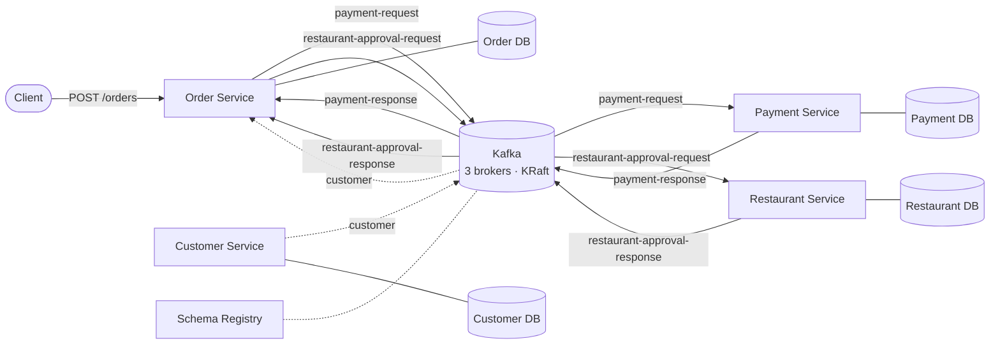
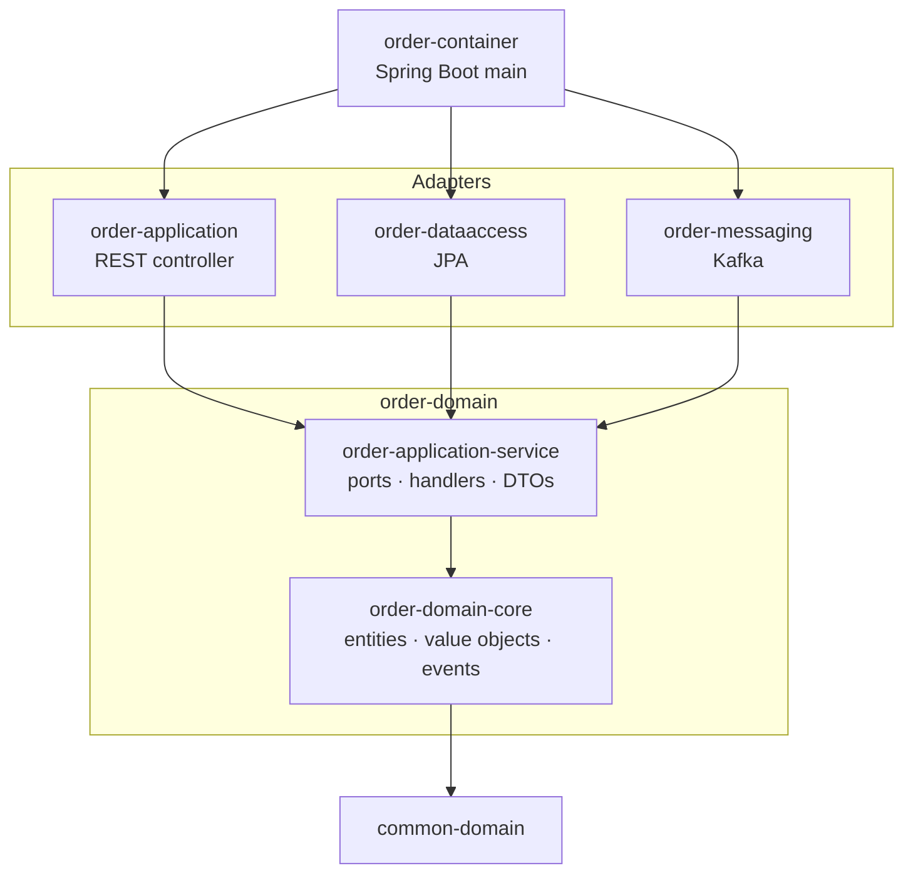
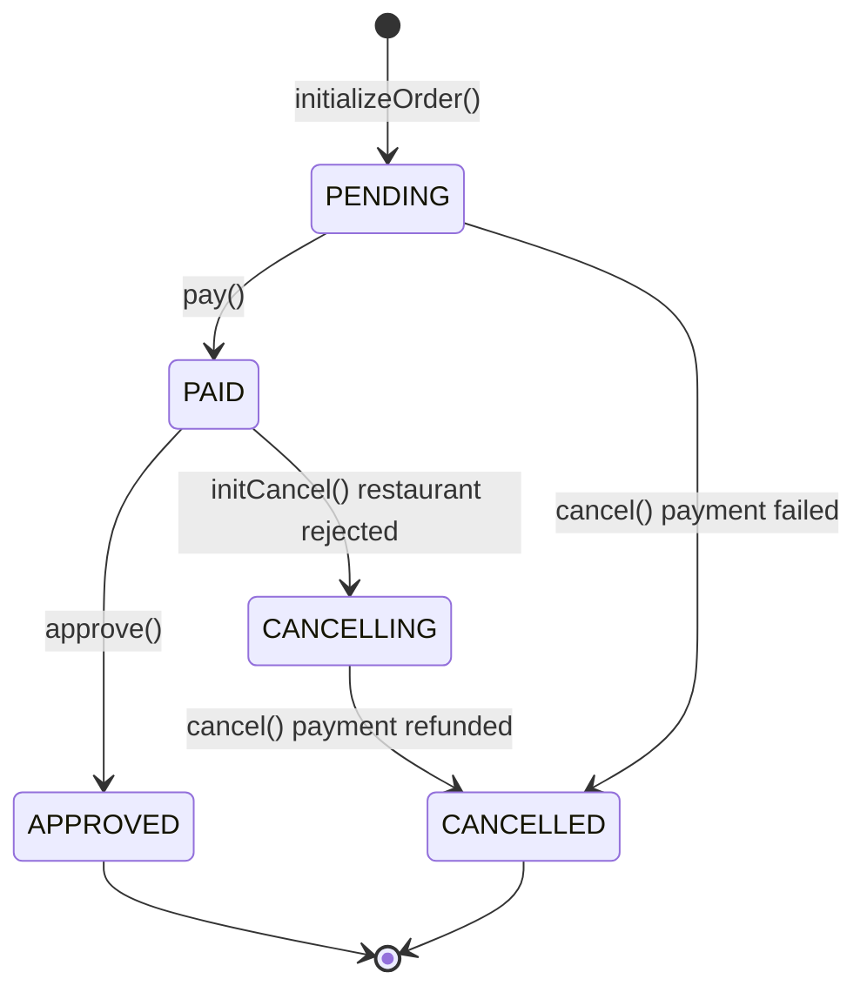
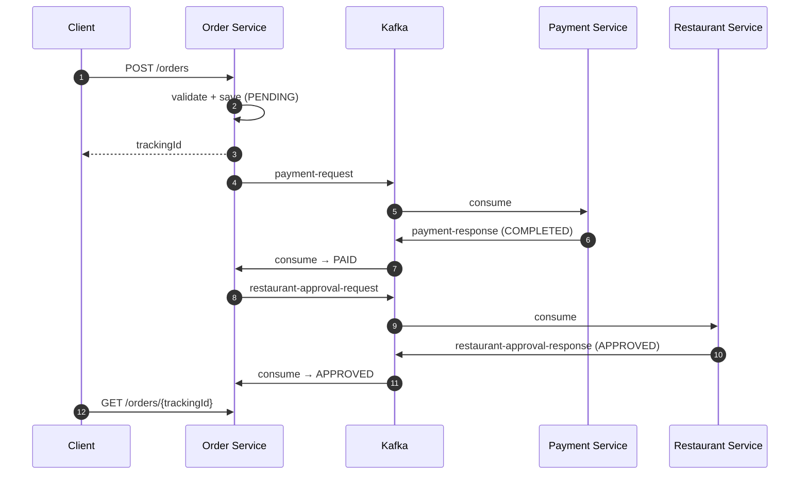

# Food Ordering System

An event-driven food ordering backend built with **Clean / Hexagonal Architecture**, **Domain-Driven Design**, the **SAGA** and **Outbox** patterns, and **Apache Kafka** as the backbone between services.

> 🚧 **Work in progress.** I'm building this project while following Ali Gelenler's course *Microservices: Clean Architecture, DDD, SAGA, Outbox & Kafka*. Every line is typed by hand. Where I made a different decision from the course, the reason is written down under [Deliberate deviations](#deliberate-deviations-from-the-course).

---

## Table of contents

- [The idea](#the-idea)
- [Architecture](#architecture)
- [Order Service: hexagonal layout](#order-service-hexagonal-layout)
- [Order lifecycle](#order-lifecycle)
- [Happy path: the SAGA](#happy-path-the-saga)
- [Kafka setup](#kafka-setup)
- [Deliberate deviations from the course](#deliberate-deviations-from-the-course)
- [Tech stack](#tech-stack)
- [Project structure](#project-structure)
- [Running locally](#running-locally)
- [Roadmap](#roadmap)

---

## The idea

A customer places an order. To complete it, three independent services must agree: the **payment** has to go through, and the **restaurant** has to approve the order. Each service owns its own database. There is no distributed transaction, so the services talk only through events on Kafka. If any step fails, earlier steps are undone with compensating events.

| Service | Responsibility |
|---|---|
| **Order Service** | Entry point (REST). Validates and creates orders, coordinates the SAGA |
| **Payment Service** | Charges or refunds the customer's credit |
| **Restaurant Service** | Approves or rejects the order (availability, active restaurant) |
| **Customer Service** | Owns customer data and shares it with Order Service (CQRS) |

---

## Architecture



- Messages are **Avro**, not JSON. Schemas live in `kafka-model`, and the Schema Registry checks compatibility when a producer registers a schema.
- The message key is the **sagaId**, so every message of one order lands on the same partition and stays in order.

---

## Order Service: hexagonal layout

The domain sits in the middle and knows no framework. Everything else is an adapter that plugs into a port.



| Module | Role |
|---|---|
| `common-domain` | Shared building blocks: `AggregateRoot`, `BaseEntity`, `Money`, typed ids, `DomainEvent`. No Spring |
| `order-domain-core` | `Order` aggregate root, `OrderItem`, `Restaurant`, `Customer`, domain events, `OrderDomainService`. No Spring |
| `order-application-service` | Input ports (REST + 2 Kafka listeners), output ports (3 repositories + 3 publishers), command handlers, transaction boundary |
| `order-application` | Primary adapter: `OrderController` |
| `order-dataaccess` | Secondary adapter: JPA repositories *(next)* |
| `order-messaging` | Secondary adapter: Kafka publishers and listeners *(next)* |
| `order-container` | The only runnable module, wires everything together *(next)* |

**Dependency rule:** arrows point inward only. The domain never imports an adapter. If it tried to, Maven would reject the cycle.

---

## Order lifecycle

State changes happen only through guarded methods on the `Order` aggregate (`pay()`, `approve()`, `initCancel()`, `cancel()`). An invalid transition throws `OrderDomainException`.



---

## Happy path: the SAGA



If the restaurant rejects the order, Order Service moves to `CANCELLING` and sends a compensating `payment-request` (CANCELLED) so Payment Service refunds the customer.

---

## Kafka setup

A local **3-broker cluster in KRaft mode** (no ZooKeeper), started with Docker Compose.

> 🖊️ **Full hand-drawn diagram:** [brokers, partition leaders, producers and consumer groups on Excalidraw](https://excalidraw.com/#json=FXJskJy_OIhSxa31w4rPT,mq5xOOGNntASXbbBMdhZ4g)

| Topic | Producer | Consumer | Partitions × RF |
|---|---|---|---|
| `payment-request` | Order | Payment | 3 × 3 |
| `payment-response` | Payment | Order | 3 × 3 |
| `restaurant-approval-request` | Order | Restaurant | 3 × 3 |
| `restaurant-approval-response` | Restaurant | Order | 3 × 3 |
| `customer` | Customer | Order | 3 × 3 |

- **Producer:** `acks=all`, `retries=5`, `snappy` compression.
- **Broker:** `min.insync.replicas=2`. A write is acknowledged only after at least 2 copies exist.
- **Consumer:** each listener runs with `concurrency=3`, one thread per partition.

The Kafka code is split into generic, service-agnostic modules that every service reuses:

| Module | Purpose |
|---|---|
| `kafka-config-data` | `@ConfigurationProperties` classes for cluster, producer and consumer settings |
| `kafka-model` | `.avsc` schemas, plus Java classes generated from them by `avro-maven-plugin` |
| `kafka-producer` | Generic producer *(next)* |
| `kafka-consumer` | Generic consumer factory *(next)* |

---

## Deliberate deviations from the course

| # | Course | This repo | Why |
|---|---|---|---|
| 1 | ZooKeeper + Confluent 7.0.1 | **KRaft** + Confluent 8.0.8 | ZooKeeper was removed in Kafka 4.0 / CP 8.x |
| 2 | kafka-manager | **kafka-ui** | kafka-manager needs ZooKeeper |
| 3 | Bind-mounted `./volumes` | **Named volumes** | macOS privacy blocked Docker writes under `~/Desktop` |
| 4 | default `min.insync.replicas=1` | **`min.insync.replicas=2`** | With `acks=all` and only one in-sync replica left, a "safe" write would be stored on a single disk |
| 5 | Payment and Order share a `group.id` (same for Restaurant and Order) | **One `group.id` per service listener** *(planned)* | Kafka builds groups by string only. A restart of Payment would trigger a rebalance that pauses Order's unrelated consumer |

I tested #4 by stopping brokers: with one broker down, writes still succeed; with two down, the producer gets `NotEnoughReplicasException`.

---

## Tech stack

| | |
|---|---|
| Language | Java 17 |
| Framework | Spring Boot 2.6.3 (kept to match the course) |
| Build | Maven multi-module |
| Messaging | Apache Kafka (Confluent Platform 8.0.8, KRaft), Spring Kafka 2.8.2 |
| Serialization | Apache Avro 1.11.0 + Confluent Schema Registry |
| Persistence | PostgreSQL + Spring Data JPA *(next)* |
| Testing | JUnit 5, Mockito |
| Coming | Outbox pattern, Debezium CDC, CQRS, Kubernetes / GKE, Spring AI |

There is also a small AI step: free-text order notes are turned into structured `OrderPreferences` (ingredients to add or remove, spice level, delivery instructions) through the `OrderNoteInterpreter` output port. The domain only sees the port. It doesn't know which model sits behind it.

---

## Project structure

```
food-ordering-system
├── common
│   └── common-domain
├── order-service
│   ├── order-domain
│   │   ├── order-domain-core
│   │   └── order-application-service
│   ├── order-application
│   ├── order-dataaccess
│   ├── order-messaging
│   └── order-container
└── infrastructure
    ├── docker-compose        # Kafka cluster, Schema Registry, kafka-ui, topic init
    └── kafka
        ├── kafka-config-data
        ├── kafka-model
        ├── kafka-producer
        └── kafka-consumer
```

---

## Running locally

**Start the Kafka cluster:**

```bash
cd infrastructure/docker-compose
docker compose -f common.yml -f kafka_cluster.yml up -d   # 3 brokers + Schema Registry + kafka-ui
docker compose -f common.yml -f init_kafka.yml up         # create the topics
```

| | |
|---|---|
| Brokers | `localhost:19092`, `localhost:29092`, `localhost:39092` |
| Schema Registry | `http://localhost:8081` |
| kafka-ui | `http://localhost:9000` |

To wipe the data, run `docker compose ... down -v`.

**Build and generate the Avro classes:**

```bash
./mvnw clean install
```

The application itself can't be started yet: `order-container` gets its main class in an upcoming step.

---

## Roadmap

- [x] `common-domain`: base entities, value objects, domain events
- [x] `order-domain-core`: `Order` aggregate, state machine, domain service
- [x] `order-application-service`: ports, DTOs, create and track handlers, unit tests
- [x] `OrderController`: REST primary adapter
- [x] AI order-note interpretation port
- [x] Kafka cluster: 3 brokers, KRaft, `min.insync.replicas=2`
- [x] `kafka-config-data`, `kafka-model` (Avro)
- [ ] `kafka-producer`, `kafka-consumer`
- [ ] `order-messaging`, `order-dataaccess`, `order-container`
- [ ] Payment Service, Restaurant Service
- [ ] SAGA with compensation
- [ ] Outbox pattern, then Debezium CDC
- [ ] Customer Service + CQRS
- [ ] Kubernetes → GKE

---

## Credits

Architecture and project idea: Ali Gelenler, *Microservices: Clean Architecture, DDD, SAGA, Outbox & Kafka* (Udemy).
Implementation, deviations and notes: [Berat Erkul](https://github.com/berat-erkul).
